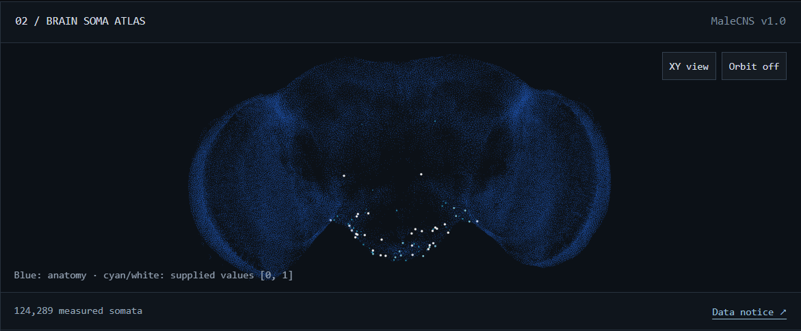

# Fly brain messaround

A small repo for me to get to grips with modeling & viewing the Male CNS Drosophila connectome.
This repo is made up of the frontend viewer, adapted from [fly-connectome-template][repo_template],
connecting to a small python websocket streaming simulated brain activity from a pytorch model provided by [victory-c/fly-brain][repo_brain].

## What it does
Running both servers displays brain activity when an input is applied in pulses (alternating on/off for several seconds at a time) to
a chosen group of input neurons.
Fairly simplistic, and nothing novel, but was a way for me to gain some familiarity with the subject matter, and the computations/models involved.

I have made some modifications to the viewer to add a "Stream model" button, which connects to the python server and displays its model outputs in the
frontend connectome viewer.

I have also added various quality of life build features via docker, taskfile, uv, etc to ease installation and running, and pre-commit/gihtub actions for CI checks.


## Pre-requisites
It is highly recomended you use the provided Dockerfile, as this bundles all the necessary pre-requisites.
If not using the dockerfile, you will need the following:

- pre-commit
- uv
- task
- npm/node

## Running
To run the backend and frontend servers, from the repo root simply run:

```
task
```

This will run any required installation of python & node packages, fetch the brain files if not existing, and run both (frontend & backend) servers in parallel.

By default, the brain model server run via this command will pulse the "sugar" input group at 100Hz, for a duration of 5 seconds on, 5 seconds off.
You can customize this with:
```
task BRAIN_SERVER_ARGS="<command line inputs to brain server>"
```

e.g.:
```
task BRAIN_SERVER_ARGS="--input-group water"
```

To view a full list of brain server command line parameters, use:
```
task brain-server BRAIN_SERVER_ARGS="--help"
```


## Licence

### Viewer

The frontend viewer (`viewer/`) is built with [fly-connectome-template][repo_template] by [Mert Cobanov][author_template].

**[Cobanov Template Attribution License 1.0](LICENSE_VIEWER)** is a custom,
attribution-required source-available license, not an OSI-approved license.

MaleCNS data remains **CC BY 4.0**, credited to FlyEM / HHMI Janelia, University
of Cambridge, MRC Laboratory of Molecular Biology and Google Research.
Flybody remains **Apache-2.0**. Their licenses are separate from the template's;
see [third-party notices](THIRD_PARTY_NOTICES.md).

[repo_template]: https://github.com/cobanov/fly-connectome-template
[author_template]: https://github.com/cobanov

### Brain Models

The spiking brain model currently used in `brain_models/victory_c_fly_brain` is taken from [victory-c/fly-brain][repo_brain].

Said code is [MIT-licensed](LICENSE_BRAIN_MODEL). The connectome data, including the prebuilt files that brain.fetch downloads, is derived from the male CNS v1.0 and licensed CC-BY 4.0; cite Berg et al., Cell 2026 (doi:10.1016/j.cell.2026.08.015). [CITATION.cff](CITATION.cff) has the references.

Connectome: male CNS v1.0, HHMI Janelia FlyEM and Google Research. Neuron model and stimulus sets: Shiu et al., Nature 2024. FlyWire cell types: Schlegel et al. / Dorkenwald et al., Nature 2024. Bicycle model: Meijaard et al., Proc. R. Soc. A 2007.

[repo_brain]: https://github.com/victory-c/fly-brain
